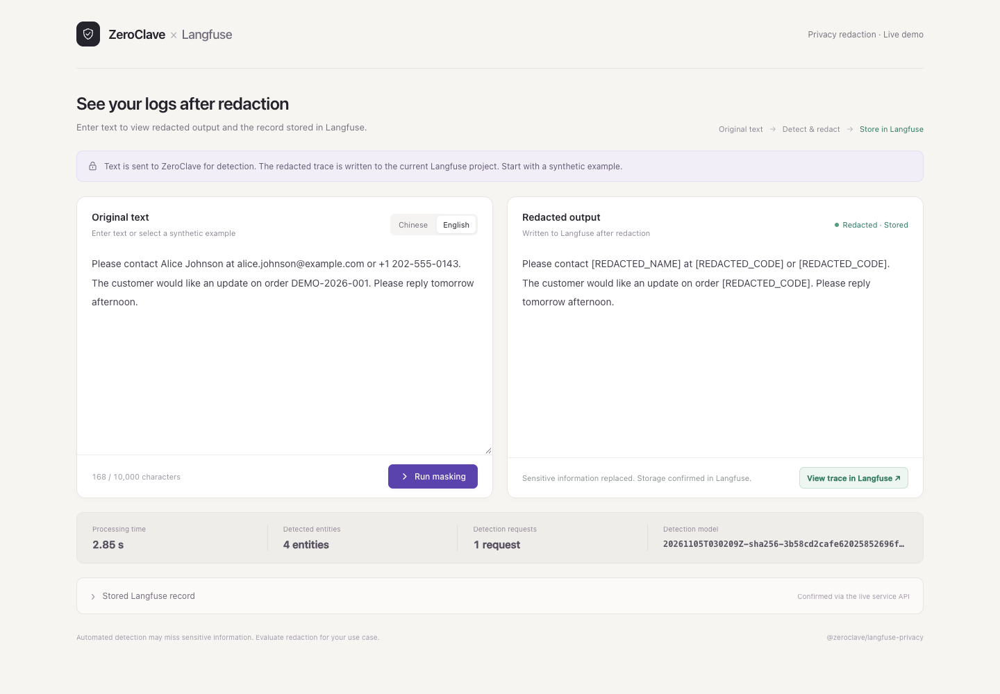
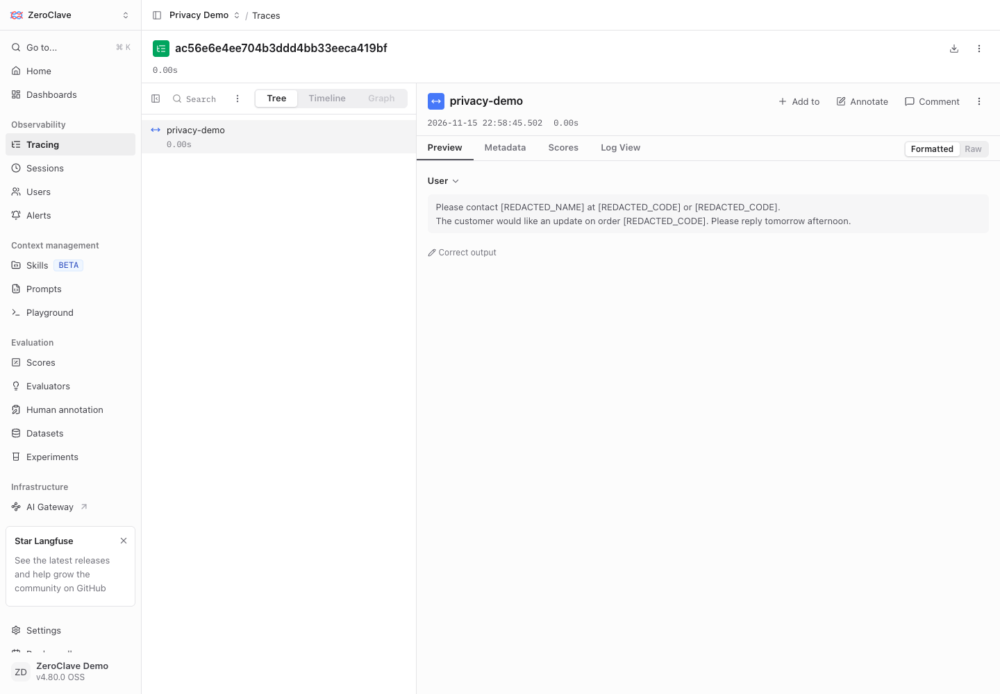

# ZeroClave Privacy for Langfuse

[简体中文](./README.zh-CN.md)

**`@zeroclave/langfuse-privacy`** masks sensitive text before Langfuse exports your traces. Add one hook to your existing Langfuse processor, detect sensitive text with [ZeroClave](https://zeroclave.com), and replace it inside your application process.

```ts
new LangfuseSpanProcessor({ mask: createZeroClaveMask() });
```

- Preserve nested objects, arrays, serialized JSON and tool arguments.
- Mask the whole supported field if detection fails, instead of exporting its original text.
- Keep your existing Langfuse project and SDK exporter. The adapter has no runtime dependencies.

**Data flow:** original text goes to ZeroClave over HTTPS for detection; replacement happens in your application before Langfuse export. See [privacy scope](#privacy-scope) for the fields this hook covers.

**Status:** `0.1.0-alpha.1` · JavaScript/TypeScript · Node.js 22+ · tested against `@langfuse/otel` 6.1.1. The package has not yet been published to npm; install from a local checkout as shown below.

## See it in action

The browser demo compares a synthetic customer message with the masked input read back from a real Langfuse project. It reports success only after Langfuse's public API returns the matching stored observation.



The same trace is visible in the Langfuse UI, with the masked text in its input:



These screenshots show the English interface, a real ZeroClave detection request, and a self-hosted Langfuse 4.80.0 project using synthetic data. Placeholder types follow the detector response. Labels and timings can vary; this example is not an accuracy or performance benchmark. The demo records an input span without making an LLM call.

## Run the demo

From a checkout of this repository:

```sh
npm ci --ignore-scripts
cp demo/.env.example .env
# Fill in your Langfuse project configuration before the next command.
npm run demo
```

Open `http://localhost:3017/?lang=en` for the English interface, run a synthetic example, and follow the trace link to inspect the stored result. The example buttons switch the interface and sample between Chinese and English. Configure these values in `.env` for your Langfuse Cloud or self-hosted project:

| Variable | Value |
| --- | --- |
| `LANGFUSE_BASE_URL` | Langfuse address reachable by the demo server. |
| `LANGFUSE_UI_URL` | Langfuse address used by the browser's trace links. |
| `LANGFUSE_PROJECT_ID` | Project ID from your Langfuse project URL. |
| `LANGFUSE_PUBLIC_KEY` | Project public API key. |
| `LANGFUSE_SECRET_KEY` | Project secret API key. |

API keys stay on the demo server. The demo sends original text to ZeroClave for detection and stores masked traces in your Langfuse project. See [demo/README.md](./demo/README.md) for local Langfuse setup and Linux deployment.

## Quick start

Until the first npm release, build and pack a local checkout:

```sh
git clone git@github.com:ZeroClave/langfuse-privacy.git
cd langfuse-privacy
npm ci --ignore-scripts
npm run check
npm pack
```

In your application:

```sh
npm install /absolute/path/to/zeroclave-langfuse-privacy-0.1.0-alpha.1.tgz
npm install @langfuse/otel@6.1.1 @opentelemetry/sdk-node@0.223.2
```

Set your application's usual `LANGFUSE_PUBLIC_KEY`, `LANGFUSE_SECRET_KEY` and `LANGFUSE_BASE_URL`. Load this instrumentation module before the application starts tracing:

```ts
import { NodeSDK } from '@opentelemetry/sdk-node';
import { LangfuseSpanProcessor } from '@langfuse/otel';
import { createZeroClaveMask } from '@zeroclave/langfuse-privacy';

export const sdk = new NodeSDK({
  spanProcessors: [new LangfuseSpanProcessor({
    mask: createZeroClaveMask(),
  })],
});

sdk.start();
// Await sdk.shutdown() in your application's shutdown handler.
```

If you already initialize OpenTelemetry, add `mask` to your existing Langfuse processor. Use one SDK initialization per application. See the [checked example](./examples/instrumentation.ts) and [Langfuse masking documentation](https://langfuse.com/docs/observability/features/masking).

## How it works

1. Langfuse calls its `mask` hook before exporting supported fields.
2. The adapter traverses strings in the value, including serialized JSON input/output and nested JSON tool arguments.
3. It sends text to ZeroClave's detection endpoint, which returns entity ranges and types.
4. The adapter replaces those ranges **inside your application process**, using the returned entity types, and returns the masked value to Langfuse. For example, a detected entity of type `NAME` becomes `[REDACTED_NAME]`.

Objects and arrays retain their structure. Serialized JSON is parsed and re-serialized, so whitespace and duplicate keys may change. Unicode codepoint offsets are converted to JavaScript UTF-16 offsets; overlapping entity ranges are merged. New valid entity types are still masked. The adapter neither changes the application's model request nor stores a restoration mapping.

## Configuration

```ts
const mask = createZeroClaveMask({
  endpoint: 'https://zeroclave.com/v1/pii/detect',
  timeoutMs: 10_000,
  maxRetries: 1,
});
```

| Option | Default | Meaning |
| --- | --- | --- |
| `endpoint` | `https://zeroclave.com/v1/pii/detect` | Full detection URL; HTTPS, or HTTP on localhost/loopback for development. No credentials, query or fragment. |
| `timeoutMs` | `10000` | Total network budget per hook invocation, shared by batches, response reading, retry delays and retries; 1–60000 ms. |
| `maxRetries` | `1` | Retries per batch for network failures and HTTP 429/503/504; 0–3. Honors `Retry-After` within the total budget. |
| `fetch` | Native `fetch` | Optional transport implementation, useful for tests or application transport configuration. |

The current public ZeroClave detection endpoint is anonymous and requires no ZeroClave API key. Anonymous rate limits apply, including shared egress limits. This adapter does not introduce an authentication or billing protocol. Langfuse credentials remain managed by Langfuse's SDK and are never sent by this adapter to ZeroClave.

Each callback accepts at most 100,000 Unicode codepoints of leaf text, 2,048 nonempty text leaves, 10,000 visited nodes, and depth 32. Arrays are limited to 10,000 slots; a serialized JSON string is limited to 1,000,000 UTF-16 units. Texts are sent in batches of up to 64; response bodies are limited to 1 MiB. Oversized inputs fail as a whole, rather than being silently truncated or splitting an entity across text chunks.

## Failure behavior

Timeouts, malformed responses, missing/stale results, invalid entity ranges, and `partial` detection **throw** a `ZeroClavePrivacyError`. There is no fallback that returns the original text. If a later batch fails, the entire callback fails.

In the tested Langfuse SDK, a thrown mask error replaces the entire corresponding property with:

```text
<fully masked due to failed mask function>
```

Error messages contain a fixed error code, without input text, server error bodies, or transport exception details. If you call the hook directly, handle its rejection; do not catch the error and return the original data.

```ts
import { ZeroClavePrivacyError } from '@zeroclave/langfuse-privacy';

try {
  const masked = await mask({ data: { message: 'Some text' } });
  // Export masked only after the hook succeeds.
} catch (error) {
  if (error instanceof ZeroClavePrivacyError) {
    // Drop or fully mask the field. error.code is safe to use for diagnostics.
  }
}
```

## Privacy scope

- **ZeroClave receives the original text over HTTPS for detection.** This adapter is not an end-to-end encrypted or local-only detector. Client-side replacement does not make text invisible to the detection service.
- Coverage follows Langfuse's SDK hook: trace/observation input and output, and observation metadata values. It does not cover every OpenTelemetry attribute, span name, ID, event, resource attribute, propagated trace metadata field, or another exporter in your application.
- Inside supported values, it scans **string values**, including nested JSON strings. Object keys, numeric and boolean values are retained. Store sensitive identifiers such as phone numbers as strings; do not put PII in keys, span names, or IDs. Opaque binary/media payloads are not inspected as media.
- `complete` means the detection request completed; it does not guarantee perfect PII recall. No local regex detector is enabled as a substitute for the SaaS.
- Circular values, accessors, non-JSON objects, malformed Unicode, and work exceeding the limits are rejected. Inputs are not mutated. Repeated values use type labels, without stable per-person correlation or restoration tokens.
- Custom transports, application logs, other processors/exporters, and data collected outside this hook require their own privacy controls. Review media-upload settings separately.

## Development

```sh
npm ci --ignore-scripts
npm run check
npm pack --dry-run
```

Tests mock the ZeroClave service. SDK tests use an in-memory exporter; demo tests exercise the actual HTTP exporter against a local collector fixture and require a successful observation read-back. They make no production calls and do not measure model accuracy or production availability. CI runs on Node 22 and 24.

### Manual live-service test

```sh
npm run test:live
```

This separate command sends built-in synthetic names, phone numbers and `example.com` email addresses to the real ZeroClave detector over HTTPS, then runs the real Langfuse processor with an in-memory exporter. No ZeroClave API key or Langfuse account is required. It does not write traces to Langfuse Cloud and is excluded from the default tests and CI.

A pass requires every request to complete with HTTP 200, all expected synthetic canaries to disappear from input/output/metadata, valid JSON, preserved emoji and non-text primitives, and no SDK failure sentinel. Failure exits nonzero: a request succeeding or a field being fully masked after an error does not count as a live-test pass.

The report at `.local/live-test-report.json` records request IDs, model versions, statuses, timings and the masked fixture. The directory is ignored by Git. No HTTP status usually indicates transport failure; non-200 or `partial` indicates service/protocol failure. Residual synthetic canaries after complete detection require a recall review. Passing these fixtures is not a general accuracy benchmark.

```sh
ZEROCLAVE_ENDPOINT=http://localhost:8080/v1/pii/detect npm run test:live
ZEROCLAVE_TIMEOUT_MS=30000 npm run test:live
```

This command validates the SDK export boundary. To verify transport, persistence and the Langfuse UI as well, [run the browser demo](#run-the-demo) with your project. The screenshots above were captured from that separate workflow.

The package is ESM and has no runtime dependency on Langfuse. Langfuse and OpenTelemetry are development dependencies for real SDK integration tests and the type-checked example. See [CONTRIBUTING.md](./CONTRIBUTING.md).

## License

Apache-2.0. See [LICENSE](./LICENSE) and [NOTICE](./NOTICE). This is a ZeroClave-maintained community integration, independent of the Langfuse project.
