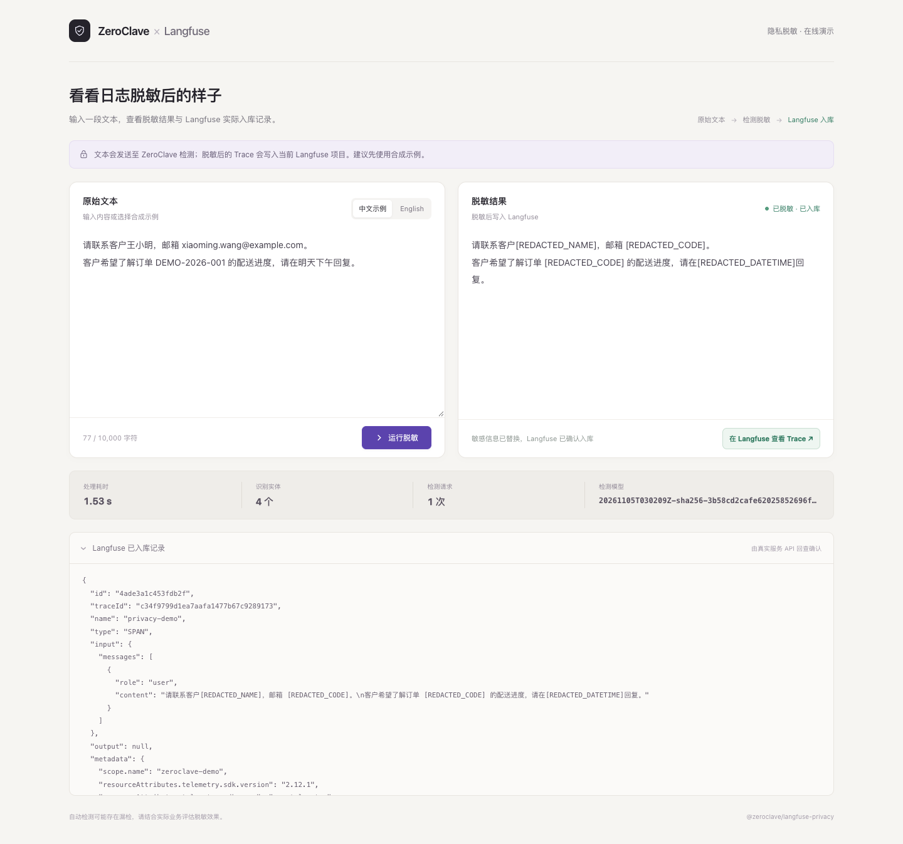
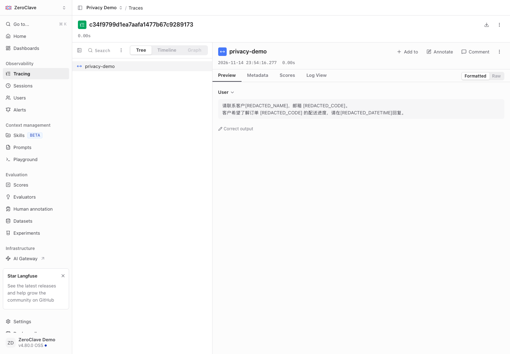

# ZeroClave Privacy for Langfuse

[English](./README.md)

`@zeroclave/langfuse-privacy` 在 Langfuse 导出 Trace 前对敏感文本做脱敏。由 [ZeroClave](https://zeroclave.com) 维护的 JavaScript/TypeScript 开源适配包，无运行时依赖。

```ts
new LangfuseSpanProcessor({ mask: createZeroClaveMask() });
```

当前版本：`0.1.0-alpha.1`，面向 JavaScript/TypeScript，要求 Node.js 22+，已使用 `@langfuse/otel` 6.1.1 做集成测试。当前为初始实现，npm 发布需单独执行。

## 效果预览

下图使用合成数据，展示真实 ZeroClave 检测、应用内替换、Langfuse API 入库回读及后台 Trace 显示的完整流程。





ZeroClave SaaS 会收到用于检测的原文；Langfuse 存储经过此适配器处理的脱敏内容。截图中的命中结果只代表该组合成数据，不能保证检测完美或不会漏检。

## 运行真实入库演示

克隆本仓库后，在仓库目录执行：

```sh
npm ci --ignore-scripts
cp demo/.env.example .env
# 在 .env 中填写自己的 Langfuse 项目配置。
npm run demo
```

浏览器打开 `http://localhost:3017`；英文界面使用 `http://localhost:3017/?lang=en`。示例按钮会同时切换界面语言和合成样例，并清空上次结果。演示支持自己的 Langfuse Cloud 或自建项目，需配置 `LANGFUSE_BASE_URL`、`LANGFUSE_UI_URL`、`LANGFUSE_PROJECT_ID`、`LANGFUSE_PUBLIC_KEY` 和 `LANGFUSE_SECRET_KEY`。密钥留在演示服务端，`.env` 已被 Git 忽略。

每次提交都会调用真实 ZeroClave 检测服务，将脱敏后的 Trace 发往所配置的 Langfuse 项目；只有通过 Langfuse API 回读到对应记录，页面才显示入库成功，并提供后台 Trace 链接。演示不调用大模型。请先使用合成数据，具体配置和本地部署方式见 [demo/README.md](./demo/README.md)。

## 腾讯云 CLS／AgentObs

[CLS 接入指南](./docs/tencent-cls.md)演示如何在同一个 Langfuse processor 中组合 ZeroClave `mask` 与自定义 OTLP exporter，将支持的 Agent Trace 字段脱敏后发往腾讯云 CLS／AgentObs。可运行示例见 [examples/tencent-cls/](./examples/tencent-cls/)，使用合成文本，需要在 `.env.cls` 中配置自己的 CLS 测试主题与凭证。

执行 `npm run demo:cls` 或 `npm run test:cls:live`，会写入合成 Trace 并通过 CLS SearchLog 读回验证。缺少配置、检测不完整或无法确认本次读回都会使命令失败。这两个真实服务命令与本地自动测试、CI 分开，不需要 Langfuse Server，也不调用大模型。ZeroClave 仍会接收检测原文；该接入不代表全部业务日志或全部 OpenTelemetry 字段已经脱敏。

`npm run test:cls` 单独运行本地 CLS 协议测试。没有腾讯云凭证时，可执行 `npm run test:cls:transport:live`，验证真实 ZeroClave 检测与 protobuf HTTP 导出到本机接收器；报告 `.local/cls-transport-live-report.json` 明确标记 `cloudPersisted: false`。真实 CLS 写入和读回仍待配置云端项目后验收，云端命令将结果写到 `.local/cls-live-test-report.json`，只有核验本次存储记录后才报告云端成功。配置项、并发上限与三层测试范围见接入指南。

## 阿里云 SLS／普通 LogStore

[SLS 接入指南](./docs/alibaba-sls.md)和[可运行示例](./examples/alibaba-sls/)在应用内处理 JSON 业务日志中的字符串，再用官方 SLS SDK 写入普通 LogStore。无需 Langfuse Server，接入路径不使用 OTLP Trace 或 SessionStore。请克隆仓库，并在 `.env.sls` 配置自己的测试项目；示例不是 npm 包的 `/sls` 导出。

`npm run demo:sls` 和 `npm run test:sls:live` 只有按本次唯一 `runId` 读回并核验存储日志后，才报告云端成功。`npm run test:sls` 运行本地协议测试；`npm run test:sls:transport:live` 使用真实 ZeroClave 检测与本地 SLS 接收器，明确记录 `cloudPersisted: false`。真实 SLS 写入和读回仍待配置云端项目后验证。示例使用合成数据；托管检测服务会收到原文，覆盖范围限于显式交给 mask 的日志字段。配置、失败行为与证据边界见接入指南。

## 接入

首个 npm 版本发布前，先在仓库内构建安装包：

```sh
git clone git@github.com:ZeroClave/langfuse-privacy.git
cd langfuse-privacy
npm ci --ignore-scripts
npm run check
npm pack
```

在业务项目中安装：

```sh
npm install /absolute/path/to/zeroclave-langfuse-privacy-0.1.0-alpha.1.tgz
npm install @langfuse/otel@6.1.1 @opentelemetry/sdk-node@0.223.2
```

设置业务项目原有的 `LANGFUSE_PUBLIC_KEY`、`LANGFUSE_SECRET_KEY`、`LANGFUSE_BASE_URL`，在应用开始追踪前加载：

```ts
import { NodeSDK } from '@opentelemetry/sdk-node';
import { LangfuseSpanProcessor } from '@langfuse/otel';
import { createZeroClaveMask } from '@zeroclave/langfuse-privacy';

export const sdk = new NodeSDK({
  spanProcessors: [new LangfuseSpanProcessor({
    mask: createZeroClaveMask(),
  })],
});

sdk.start();
// 在应用退出处理函数中 await sdk.shutdown()。
```

已有 OpenTelemetry 初始化时，给现有 Langfuse processor 加上 `mask` 即可。一个应用只初始化一次 SDK。完整示例见 [examples/instrumentation.ts](./examples/instrumentation.ts)。

## 数据流

1. Langfuse 在导出支持的字段前调用 `mask`。
2. 适配器提取嵌套对象、数组、JSON 字符串及工具参数 JSON 中的字符串值。
3. 将这些原文通过 HTTPS 发给 ZeroClave SaaS，获取敏感实体的位置和类型。
4. 在业务应用进程内替换，例如 `alice@example.com` → `[REDACTED_CODE]`（与截图中的占位符类型一致），再交给 Langfuse 导出。占位符沿用检测服务返回的实体类型，可能随模型变化；不保证所有邮箱都标为 `EMAIL`。

对象与数组保持结构；JSON 字符串会重新序列化，空白格式与重复键可能变化。正确处理 emoji 对应的 Unicode codepoint 偏移，合并重叠实体；遇到新增的合法实体类型仍然脱敏。不会修改实际发给模型的请求，也不保存还原映射。

## 配置

```ts
const mask = createZeroClaveMask({
  endpoint: 'https://zeroclave.com/v1/pii/detect',
  timeoutMs: 10_000,
  maxRetries: 1,
});
```

| 参数 | 默认值 | 含义 |
| --- | --- | --- |
| `endpoint` | `https://zeroclave.com/v1/pii/detect` | 完整检测 URL；要求 HTTPS，本地 loopback 调试允许 HTTP。禁止 URL 内嵌凭证、查询参数和 fragment。 |
| `timeoutMs` | `10000` | 单次回调的网络总预算，包括所有批次、读取响应、退避及重试；1–60000 毫秒。 |
| `maxRetries` | `1` | 每批针对网络异常和 HTTP 429/503/504 的重试次数；0–3。在总预算内遵循 `Retry-After`。 |
| `fetch` | 原生 `fetch` | 可注入测试或业务自定义传输实现。 |

当前公开检测接口匿名调用，无需 ZeroClave API key，会受到匿名接口限流及共享出口限制。适配器没有另行虚构鉴权或计费协议。Langfuse 密钥由其 SDK 管理，本包不会将其发送给 ZeroClave。

每次回调最多处理 100,000 个字符串值 codepoint、2,048 个非空字符串、10,000 个遍历节点和 32 层深度。数组最多 10,000 个位置，单个 JSON 字符串最多 1,000,000 个 UTF-16 单元。每批最多 64 段文本，响应体最多 1 MiB。超限整体失败，不截断文本，也不把单个字符串拆开而漏掉跨边界实体。

## 失败时如何处理

超时、响应不合法、结果缺失或版本过期、实体偏移不合法、检测返回 `partial` 时，回调抛出 `ZeroClavePrivacyError`，**不会回退到原文**。后续批次失败时，整个回调失败。

在已测试的 Langfuse SDK 中，回调异常会让对应整个字段变成：

```text
<fully masked due to failed mask function>
```

错误只包含固定错误码，不附带原文、服务端错误体或网络异常详情。直接调用本包回调时，也必须处理拒绝；不能在 catch 中返回原文。

## 隐私边界

- **原文会通过 HTTPS 发送到 ZeroClave 检测服务。** 这是 SaaS 检测，不是纯本地检测或端到端加密检测；本地执行替换不等于检测服务看不到原文。
- 覆盖范围由 Langfuse `mask` 决定：trace/observation 的 input、output，以及 observation metadata 的值。不能把它当作所有 OpenTelemetry 字段的统一脱敏层；span 名、ID、event、resource、部分传播的 trace metadata 等需单独管理。
- 支持字段内部扫描字符串值，包括嵌套 JSON 字符串；**对象键名、数字和布尔值保持原样**。手机号等敏感标识请用字符串存储，不要把 PII 放进键名、span 名或 ID。二进制与媒体内容不作为媒体解析。
- `complete` 仅代表检测完整返回，不保证没有漏检。当前没有用本地正则替代 SaaS 检测。
- 循环引用、访问器、非 JSON 对象、非法 Unicode 和超限数据会被拒绝，不修改输入对象。占位符只表达实体类别，不提供跨记录身份关联或还原能力。
- 自定义传输、业务日志、其他 processor/exporter，以及 hook 范围外的数据需要各自的隐私措施；媒体上传配置也需单独检查。

## 开发与测试

上方的[真实入库演示](#运行真实入库演示)用于验证 Langfuse 收集、存储和后台展示。以下命令用于开发检查：

```sh
npm ci --ignore-scripts
npm run check
npm pack --dry-run
```

测试使用 mock ZeroClave 服务；SDK 测试使用内存 exporter，演示测试通过实际 HTTP exporter 发送至本地收集端 fixture，并要求查询回已存储的观察记录。自动测试不调用生产服务，也不验证实际模型准确率或线上可用性。CI 在 Node 22 和 24 上运行。

### 仅测试真实 SaaS 与 SDK 导出

```sh
npm run test:live
```

`test:live` 单独执行，不在默认测试或 CI 中运行。它将内置的虚构姓名、手机号、`example.com` 邮箱通过 HTTPS 发给真实 ZeroClave，经过真实 Langfuse SDK 脱敏后导出到本地内存。无需 ZeroClave API key，也无需 Langfuse 账号或密钥；该测试不向任何 Langfuse 项目写入 Trace。

通过条件包括：全部请求返回 HTTP 200 且检测完整；input、output、metadata 中的合成敏感值都已替换；导出结果不是失败时的整字段占位符；JSON 可以解析，emoji、普通数字与布尔值保持正确。任何一项失败，进程都以非零状态退出，不能把“请求成功”或“整字段被屏蔽”当作联调通过。

报告保存到 `.local/live-test-report.json`，包含请求 ID、模型版本、检测状态、耗时及脱敏后的示例，目录已被 Git 忽略。失败时先检查报告：无 HTTP 状态多为网络问题，非 200 或 `partial` 是服务/协议问题；完整响应下合成敏感值仍残留时，需要检查检测召回。示例命中不代表对所有数据都有相同识别率。

可指定开发检测服务或调整单次 hook 的超时：

```sh
ZEROCLAVE_ENDPOINT=http://localhost:8080/v1/pii/detect npm run test:live
ZEROCLAVE_TIMEOUT_MS=30000 npm run test:live
```

`test:live` 的验证止于 SDK 导出边界。需要验证 Langfuse 网络收集、持久化及后台页面时，请运行上方的真实入库演示；该演示会向自己的项目写入 Trace，并通过 API 回读确认。

包使用 ESM，没有 Langfuse 运行时依赖；Langfuse 与 OpenTelemetry 只用于开发阶段的真实 SDK 集成测试和示例类型检查。贡献说明见 [CONTRIBUTING.md](./CONTRIBUTING.md)。

## 开源协议

Apache-2.0，见 [LICENSE](./LICENSE) 与 [NOTICE](./NOTICE)。本项目是 ZeroClave 维护的社区集成。
