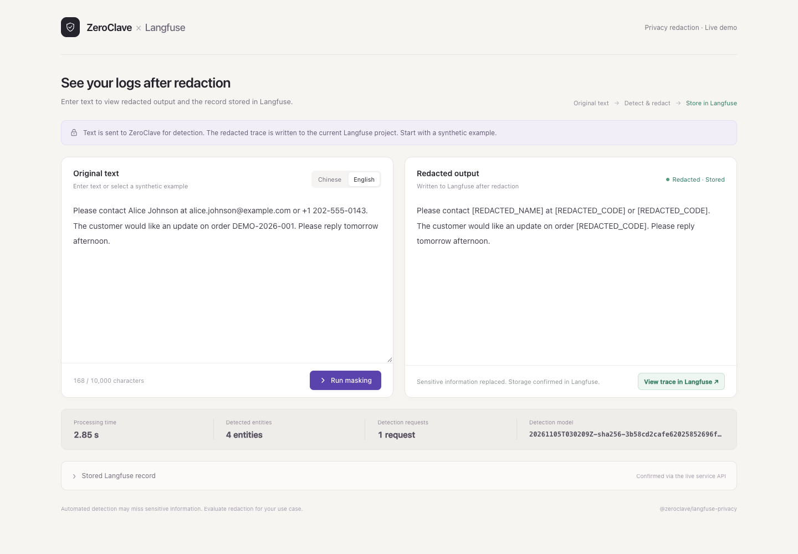
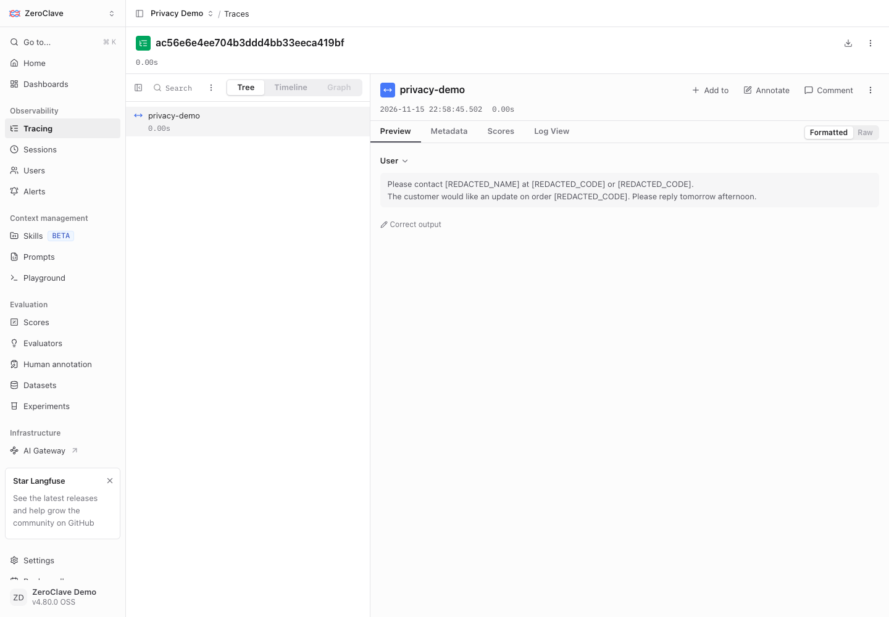

# Browser demo with real Langfuse storage

The demo sends text to ZeroClave for detection, masks it in the application, and uses the actual Langfuse OTLP exporter to send the trace to your Langfuse project. It queries Langfuse's public API by trace/span ID and reports success only after reading back the stored observation. The page displays that stored input and links to the real trace.

## Screenshots

The built-in synthetic customer message, its masked result, and the observation read back from Langfuse:



The corresponding trace in a self-hosted Langfuse 4.80.0 project:



The examples use synthetic data and do not call an LLM. Placeholder types come from ZeroClave's response. The displayed timing describes that request only. Chinese captures are retained in the [Chinese README](../README.zh-CN.md).

## Run

Use a Langfuse Cloud or self-hosted project:

```sh
npm ci --ignore-scripts
cp demo/.env.example .env
# Fill in project ID, public/secret API keys, and server/UI URLs.
npm run demo
```

Open `http://localhost:3017/?lang=en` for English, or `http://localhost:3017/` for Chinese. The example buttons switch both the interface language and synthetic sample; switching clears the previous result. The CLI loads `.env`, which is ignored by Git. API keys stay on the server; they are never sent to the browser or ZeroClave. The default listener is loopback. Set `HOST=0.0.0.0` for an OrbStack VM, or `PORT` for another port. `ZEROCLAVE_ENDPOINT` and `ZEROCLAVE_TIMEOUT_MS` override the detector URL and 15-second budget.

`LANGFUSE_BASE_URL` is the backend's Langfuse address. `LANGFUSE_UI_URL` is the browser address for trace links. `LANGFUSE_PROJECT_ID` comes from the project URL. All three and `LANGFUSE_PUBLIC_KEY` / `LANGFUSE_SECRET_KEY` are required; there is no automatic memory-only fallback.

Use the synthetic examples first. Original text is sent to ZeroClave for detection. **Masked traces are stored in your Langfuse project** and retained according to its policy. The demo server does not separately save submitted text to disk. This development interface has no accounts or authentication; keep it on your development network.

The demo does not call an LLM. Each request records a span with its input. A single Langfuse processor awaits masking before the default HTTP exporter runs, without a parallel unmasked exporter. Partial/failed detection produces a full-field mask and a page error. If ingestion succeeds but confirmation fails, the page reports failure; a trace may already exist in that case.

Inputs are capped at 10,000 UTF-16 units and two concurrent requests. API read-back has a 20-second budget after SDK flush. An empty detection result is shown without claiming that the text contains no PII.

## Local Langfuse on Linux

The optional bootstrap follows the [official v4.80.0 compose](https://github.com/langfuse/langfuse/blob/v4.80.0/docker-compose.yml) and [headless initialization](https://langfuse.com/self-hosting/administration/headless-initialization). It requires Docker Compose, Python and PyYAML. It runs web, worker, PostgreSQL, ClickHouse, Redis and MinIO, with separate persistent named volumes. It does not start AI Gateway.

```sh
mkdir -p ~/apps/langfuse
curl -fLsS https://raw.githubusercontent.com/langfuse/langfuse/v4.80.0/docker-compose.yml \
  -o ~/apps/langfuse/docker-compose.upstream.yml
python3 demo/setup-langfuse.py ~/apps/langfuse
cd ~/apps/langfuse
sudo docker-compose -p zeroclave-langfuse up -d
```

The bootstrap creates host-local `.env` and `demo.env` with random credentials and mode 0600, preserving credentials on later runs. Copy `demo.env` to the demo checkout's `.env`. Login details are `LANGFUSE_INIT_USER_EMAIL` / `LANGFUSE_INIT_USER_PASSWORD` in the stack's `.env`; do not expose or commit it. Set `NEXTAUTH_URL` before initial startup if the browser address differs from `http://127.0.0.1:3000`.

Keep the named volumes to preserve traces. `docker-compose down` stops containers; `down -v` deletes databases and stored traces.

## Linux demo service

Build and run `npm run check`. Render `zeroclave-langfuse-demo.service.in` with your non-root `@USER@`, absolute checkout `@ROOT@`, and `@NODE@` executable. Install the result in `/etc/systemd/system/zeroclave-langfuse-demo.service`. Credentials are read from `@ROOT@/.env`.

```sh
sudo systemctl daemon-reload
sudo systemctl enable --now zeroclave-langfuse-demo
sudo systemctl status zeroclave-langfuse-demo
```

The service listens on port 3017 with read-only application access and restarts on failure.

## Refresh the screenshots

Open `/?lang=en`, run the built-in English synthetic example, and wait for the page to confirm Langfuse persistence. Capture the demo as `docs/images/privacy-demo-en.png`. Follow the trace link, sign in to your project, and wait until the actual masked input has loaded before capturing `docs/images/langfuse-trace-en.png`. Use the Chinese interface and sample for `privacy-demo.png` and `langfuse-trace.png`.

Capture the result and trace views; keep API keys, login forms, and real customer data out of the images. Both main READMEs use these repository-relative image paths so the screenshots render on GitHub.
